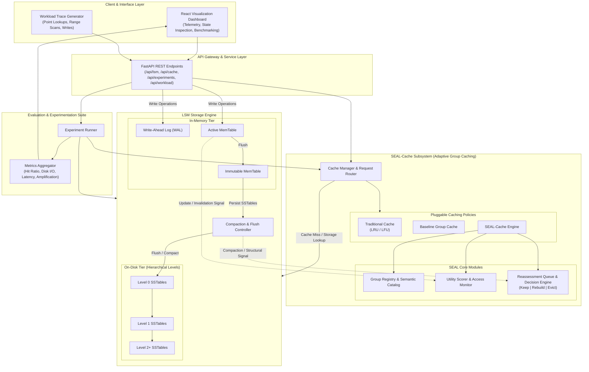
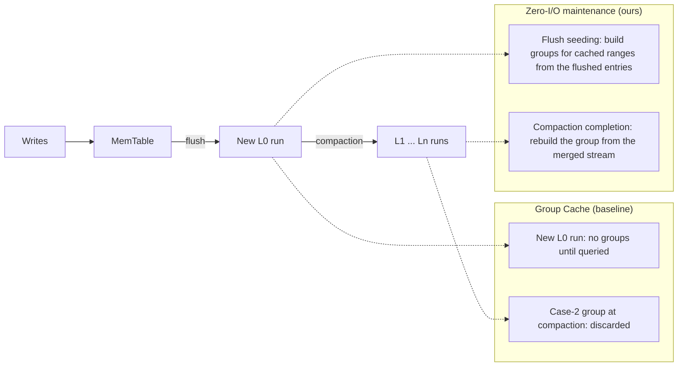

# LSM cache testbed (zero-I/O KV-group maintenance)

Research testbed for comparing LSM-tree caches (block, Range Cache, Group Cache)
and our zero-I/O KV-group maintenance mechanism. See `CLAUDE.md` (status, rules) and `docs/DECISIONS.md` (rationale).

## Run
Backend (Python 3.11+):

    cd backend
    pip install -r requirements.txt
    python -m tests.test_engine && python -m tests.test_service && python -m tests.test_group_cache  # 17 tests
    python -m app.experiments.motivation                         # go/no-go experiment (~2-3 min)
    python run.py                                                 # API on :8000, docs at /docs

Frontend (Node 18+), in a second terminal:

    cd frontend
    npm install
    npm run dev                                                   # http://localhost:5173

## Structure
    backend/
      app/
        lsm/          block-level LSM engine, I/O accounting, flush/compaction hooks
        correctness/  reference model + differential testing
        workload/     deterministic uniform/Zipf workload generator
        cache/        (week 2) cache designs
        experiments/  (weeks 1-3) motivation measurement and sweeps
        api/          FastAPI routes
        service.py    session logic used by the API
      tests/
    frontend/
      src/components/ Strata (levels on a key axis), Controls, QueryReport

Experiment numbers for the paper come from `backend/app/experiments`, never from the UI.
# SEAL-Cache

## Semantic Eviction and Adaptive Loading for Dynamic LSM-Tree Group Caching

SEAL-Cache is an experimental systems research project that investigates adaptive caching for dynamic Log-Structured Merge-tree (LSM) key-value storage engines.

LSM-based key-value stores provide high write throughput, but maintaining effective caching remains challenging under dynamic workloads. While traditional Group Caching groups logically related key-value data to accelerate access, frequent writes, MemTable flushes, and background compactions continuously reorganize the underlying SSTables, degrading the accuracy and utility of previously cached groups.

**SEAL-Cache** introduces an adaptive caching paradigm: instead of immediately evicting a cached group when its underlying storage structure updates, the system monitors access behavior, update intensity, and compaction signals to mark affected groups for dynamic reassessment—deciding whether to **Keep**, **Rebuild**, or **Evict**.

---

## System Architecture



### Architectural Components

- **Client & Interface Layer**: Includes the interactive React dashboard for live storage inspection and workload controls, alongside a synthetic and trace-based workload generator.
- **API Gateway**: FastAPI service routing commands across storage, cache, workload generation, and experiment controllers.
- **SEAL-Cache Subsystem**:
  - **Cache Manager**: Coordinates lookups, insertions, and dispatches across Traditional (LRU/LFU), Baseline Group, and SEAL-Cache policies.
  - **Group Registry**: Organizes keys into logically related groups based on query predicates or semantic tags.
  - **Utility Scorer**: Continuously updates utility weights based on hit frequency, access recency, and write penalty.
  - **Reassessment Queue**: Processes structural change notices from the LSM engine, triggering targeted decisions (`KEEP`, `REBUILD`, or `EVICT`) rather than immediate blind invalidation.
- **LSM Storage Engine**: Hierarchical LSM implementation featuring active/immutable MemTables, Write-Ahead Logging (WAL), on-disk leveled SSTables, and a Compaction & Flush controller.
- **Evaluation & Experimentation Suite**: Orchestrates reproducible benchmark experiments across policies and logs performance telemetry (cache hit ratio, disk read/write amplification, and request latency).

---

## Implementation Progress

### Completed So Far

- [x] **Project Skeleton & Directory Organization**: Structured backend modular packages (`api`, `cache`, `lsm`, `workload`, `experiments`) and frontend workspace.
- [x] **LSM Storage Engine Foundation**:
  - In-memory MemTable implementation with sorted key-value storage.
  - SSTable disk layout with index blocks and key ranges.
  - Leveled hierarchy structure with MemTable-to-L0 flush operations.
  - Basic level-to-level compaction triggers and key merging.
- [x] **Multi-Policy Caching Framework**:
  - Extensible cache abstraction supporting modular replacement algorithms.
  - Traditional baseline caching policies (LRU and LFU implementations).
  - Baseline static Group Cache implementation for bundled key retrievals.
- [x] **SEAL-Cache Core Mechanics**:
  - Semantic group metadata indexing and key-to-group mapping.
  - Dynamic utility scoring algorithm based on access frequency and write recency.
  - Reassessment queue model for evaluating degraded groups.
- [x] **Workload Generation & Benchmarking Base**:
  - Request synthesis engine supporting point reads (`GET`), insertions/updates (`PUT`), and range scans (`SCAN`).
  - Experiment execution harness collecting cache hits, misses, disk I/O, and latency statistics.
- [x] **Frontend Dashboard Architecture**:
  - React application setup for visualizing MemTable status, SSTable level distribution, and cache performance metrics.

---

## Repository Structure

```
├── backend/
│   ├── app/
│   │   ├── api/             # FastAPI route handlers and request models
│   │   ├── cache/           # Caching engine and policies (LRU, LFU, Group, SEAL)
│   │   │   └── policies/    # Specific eviction and reassessment strategies
│   │   ├── experiments/     # Benchmark runner and metrics collection
│   │   ├── lsm/             # LSM engine (MemTable, SSTable, Compaction)
│   │   └── workload/        # Workload trace generator and request definitions
│   ├── requirements.txt     # Python backend dependencies
│   └── run.py               # Backend entrypoint
├── frontend/
│   ├── src/                 # React components, dashboard views, and visualizers
│   ├── package.json         # Frontend dependencies and scripts
│   └── vite.config.js       # Vite build configuration
└── README.md
```

---

## How to Run

### Step 1: Start Backend

```bash
cd backend
python -m venv venv
venv\Scripts\activate       # On Linux/macOS: source venv/bin/activate
pip install -r requirements.txt
python run.py
```

- **Backend API**: `http://localhost:8000`
- **Swagger Documentation**: `http://localhost:8000/docs`

### Step 2: Start Frontend

```bash
cd frontend
npm install
npm run dev
```

- **Dashboard UI**: `http://localhost:5173`
- # LSM cache testbed: zero-I/O KV-group maintenance

A simulator and evaluation harness for caches in LSM-trees. It compares a block cache, Range Cache
and Group Cache against **zero-I/O KV-group maintenance**, a mechanism that keeps a Group Cache
useful under writes by doing its cache work during flushes and compactions, using data that is
already in memory.

Graphic Era team project OSDBMS-V-2026-T082: Sneha Kuriyal (lead), Tanishka Gupta, Simran Arya,
Shruti Rana.

- [Background](#background)
- [The mechanism](#the-mechanism)
- [Architecture](#architecture)
- [Quick start](#quick-start)
- [Running the experiments](#running-the-experiments)
- [Methodology](#methodology)
- [Results](#results)
- [Web UI](#web-ui)
- [Screenshots](#screenshots)
- [Repository layout](#repository-layout)
- [Limitations](#limitations)
- [References](#references)

## Background

An LSM-tree buffers writes in an in-memory MemTable, flushes it to disk as a sorted run (level
L0), and merges runs into deeper levels through compaction. Reads may have to check several runs,
so caching matters.

**Group Cache** (Wang et al., PACMMOD/SIGMOD 2026, doi
[10.1145/3786661](https://doi.org/10.1145/3786661)) caches *KV groups*: the keys a query needs from
one block of one sorted run. A cached group saves exactly one block read. It beats block caches and
Range Cache on read-heavy workloads, but its own paper documents two weaknesses under writes:

1. **Fresh data is cold.** A newly flushed L0 run has no groups until a query reads it.
2. **Compaction discards groups.** When compaction merges a cached run with keys the group did not
   hold (the paper's *Case 2*), the group is thrown away.

## The mechanism

Zero-I/O KV-group maintenance closes both gaps without any extra disk reads:

- **Flush seeding.** When the MemTable is flushed, build groups in the new L0 run for every key
  range that is currently cached anywhere, using the flushed entries (already in memory).
- **Compaction completion.** Instead of discarding a Case-2 group, rebuild it complete from the
  compaction's merged output stream (also already in memory).



Both actions only copy entries that the flush or compaction already holds in memory, so the
mechanism adds CPU and memory work (measured, see [Methodology](#methodology)) but no disk I/O.

## Architecture

```mermaid
flowchart TB
    subgraph SIM["Simulator core (Python, stdlib only)"]
        GEN["workload/generator.py<br/>deterministic uniform / Zipf traces"]
        ENG["lsm/engine.py<br/>MemTable, flush, leveling or tiering compaction"]
        IO["lsm/io.py<br/>block I/O counted by cause and level"]
        CACHE["cache/<br/>block, Range Cache, Group Cache + our mechanism"]
        REF["correctness/reference.py<br/>reference model, differential tests"]
        GEN --> ENG
        ENG --> IO
        ENG -- "on_flush / on_compaction hooks" --> CACHE
        CACHE -- "lookup / admit" --> ENG
        REF -. "checks every answer" .-> ENG
    end

    EXP["experiments/common.py run_trace()<br/>fidelity.py sweeps, run_week3.sh"]
    CSV[("backend/results/*.csv")]
    ANA["analysis/<br/>paired.py, figures.py, summarize_week3.py"]
    API["FastAPI<br/>service.py, api/routes.py"]
    UI["React + Vite UI<br/>Benchmark, Results, Engine lab"]

    SIM --> EXP --> CSV --> ANA
    CSV --> API
    SIM --> API --> UI
```



Every cache gets the same engine, the same operation trace and the same byte budget. Results for
the paper come only from `backend/app/experiments`; the UI reads those CSVs or runs small demos
through the same `run_trace()` code.

## Quick start

Requirements: Python 3.11+ and Node 18+.

**Backend and tests**

```bash
cd backend
pip install -r requirements.txt
python -m tests.test_engine && python -m tests.test_service && python -m tests.test_group_cache \
  && python -m tests.test_baselines && python -m tests.test_api      # 40 tests
python run.py                                                         # API on :8000, docs at /docs
```

The simulator core needs only the standard library; FastAPI, uvicorn and httpx are for the API
and its tests.

**Frontend** (second terminal)

```bash
cd frontend
npm install
npm run dev                                                           # http://localhost:5173
```

If port 8000 is taken, start the API on another port (`uvicorn app.main:app --port 8001` from
`backend/`) and point the frontend at it with `API_TARGET=http://127.0.0.1:8001 npm run dev`.

## Running the experiments

All headline experiments use fresh seeds 6-15 and the paper's write mix (half of the writes insert
new keys).

```bash
cd backend
bash run_week3.sh                     # all week-3 sweeps (write, scan, size, zipf, tiering,
                                      # block16, 160K warm-up); ~2 h on 12 cores
bash run_week3.sh write scan          # or just some of them
bash run_week3_rules.sh               # decision-rule re-validation

# a single sweep
python -m app.experiments.fidelity --sweep write --insert-share 0.5 --block-size 48 \
  --keys 200000 --warmup 40000 --ops 40000 --seeds 10 --seed-offset 6 \
  --caches none,block,range,group,zio-naive,group+seed,group+complete --workers 12
```

Analysis (from the repository root):

```bash
python analysis/paired.py backend/results/week3/write_sweep_200k.csv --param write_ratio
python analysis/figures.py backend/results/week3/write_sweep_200k.csv --outdir analysis/figures
python analysis/figures.py backend/results/week3/scan_sweep_200k.csv --kind sweep \
  --param scan_share --name fig_scan --xlabel "scan share of reads"
python analysis/summarize_week3.py > backend/results/week3/SUMMARY_tables.md
```

`--workers N` runs seeds in parallel; every run keeps its own seed, so results are identical to a
single-process run.

## Methodology

| Item | Choice |
|---|---|
| Main metric | Query block reads per query (gets + scans). Hit rate is secondary. |
| Budgets | Equal **byte** budgets for all caches, metadata included (Group Cache paper's formulas). |
| Correctness | Every cache must pass the differential tests against a reference model before benchmarks. |
| Workload | Zipf 0.8 by default, 20% of reads are scans of 10-100 keys, 50% inserts / 50% updates among writes. |
| Scale | 200K keys (4 levels), 48-key blocks (16 as sensitivity), cache = 5% of the initial data. |
| Protocol | 40K warm-up + 40K measured operations; warm-up and measured traces share one hot-key set. |
| Seeds | 0-5 used for tuning and validation; headline numbers use fresh seeds 6-15. |
| Statistics | Paired per-seed comparisons with 95% t-intervals; losses and non-significant results are reported. |
| Overhead | Per mechanism: groups created, KVs copied in memory, cache bytes held, groups hit vs never hit. |

Filters are ideal (no false positives), as Group Cache itself assumes for range filters. The full
decision log, including a warm-up protocol flaw that was found and fixed during week 3, is in
[`docs/DECISIONS.md`](docs/DECISIONS.md).

## Results

Result CSVs live in `backend/results/` (one folder per project step). The week-3 evaluation is in
`backend/results/week3/`; runs made before the warm-up fix are kept in
`backend/results/week3/mismatched_warmup/` as sensitivity data only.

The validated numbers and their interpretation are in `backend/results/week3/SUMMARY.md` (being
written) and `docs/DECISIONS.md` §11. They are not repeated here so this file cannot drift from the
data.

## Web UI

The UI is for exploring and teaching, not for producing paper numbers.

- **Benchmark**: pick a workload and run every cache on an identical trace at demo scale (up to
  30K keys). Shows reads per query, savings vs no cache, and paired comparisons with confidence
  intervals.
- **Results**: browse the experiment CSVs: reads per query and paired gains across a sweep, per-value
  summaries with sparklines, and a table view.
- **Engine lab**: two engines receive the same operations with different caches. Shows the
  storage tree with cached groups, a flush/compaction log with each cache's reaction (seeded,
  completed, rebuilt, discarded), and guided scenarios such as "fresh data is cold" and "compaction
  and Case 2".

## Screenshots

<!-- Add screenshots to docs/screenshots/ and update the paths below. -->

| View | Screenshot |
|---|---|
| Benchmark | 
 |
| Results | 
 |
| Engine lab | 
 |

## Repository layout

```
backend/
  app/
    lsm/            engine (per-file leveling, whole-level merges, tiering), runs, I/O accounting
    cache/          block_cache.py, range_cache.py, group_cache.py (baseline + our mechanism)
    correctness/    reference model and differential testing
    workload/       deterministic uniform / Zipf generator
    experiments/    run_trace(), fidelity sweeps, warm-up calibration, week-1 motivation
    api/            FastAPI routes
    service.py      engine sessions, event log, cache inspector, demo benchmark
    results_view.py read-only CSV aggregation for the UI
  tests/            engine, service, group cache, baselines, API (40 tests)
  results/          experiment CSVs and step summaries
  run_week3.sh      all week-3 sweeps
analysis/           paired statistics, figures, summary tables
docs/DECISIONS.md   decision log, claims, threats to validity, paper plan
frontend/           React + Vite UI
```

## Limitations

- A simulator, not RocksDB: claims are about disk block reads only. No latency or throughput
  claims are made.
- Moderate scale (200K keys, 4 levels), ideal filters, integer keys and synthetic Zipf workloads.
- Group Cache and Range Cache are reimplemented from their papers (no public code); the
  deviations are listed in `docs/DECISIONS.md` §4.
- With inserts the database keeps growing, so there is no steady state; absolute numbers depend
  on the warm-up and measurement lengths, which are fixed for all runs.

## References

- Wang et al. Group Cache. PACMMOD (SIGMOD 2026). doi:10.1145/3786661.
- Related work considered (Range Cache, LSbM, HotRAP, SAS-Cache, AdCache and others) is listed with
  its relation to this project in `docs/DECISIONS.md` §1-§3.

